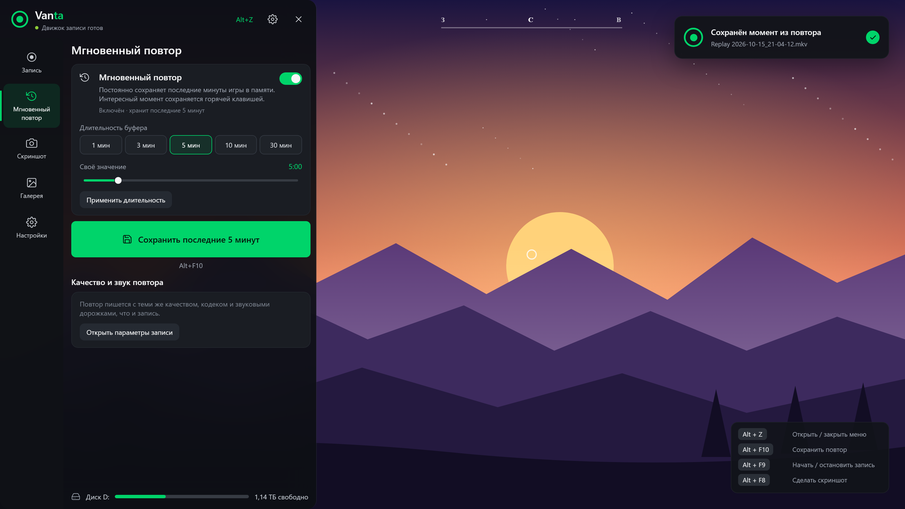
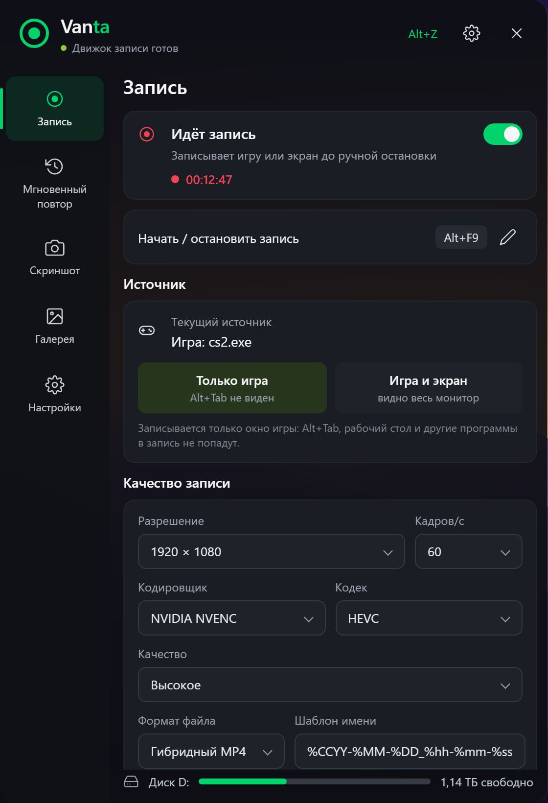
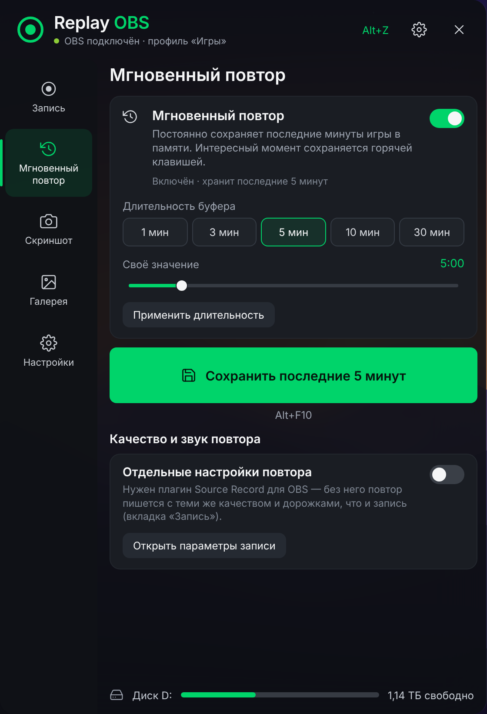
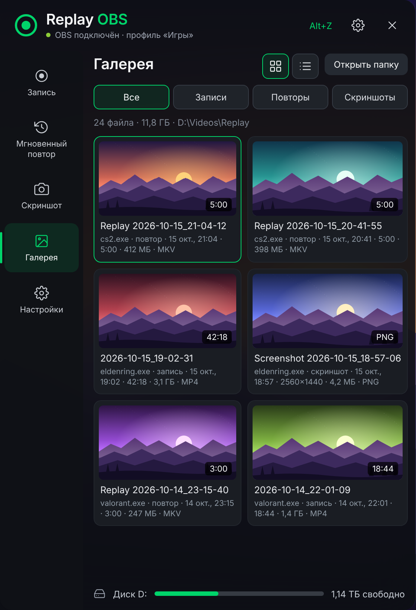

  

<h1 align="center">Vanta</h1>

  Мгновенный повтор поверх игр — как <b>Alt+Z</b> у NVIDIA ShadowPlay. 
  Записывает собственный скрытый движок на основе OBS Studio: ставится сам, окна не показывает.

  
  
  
  
  

  
   Для ПК на Windows 10 / 11 · бесплатно, открытый код · OBS Studio ставить не нужно

  

## Что умеет

<table>
  <tr>
    <td width="50%">⏪ <b>Мгновенный повтор</b> сохранить последние минуты игры одной клавишей (до 30 мин)</td>
    <td width="50%">⏺️ <b>Запись</b> «только игра» или «игра и экран», NVENC / AMF / Quick Sync / x264</td>
  </tr>
  <tr>
    <td width="50%">📸 <b>Скриншоты</b> игра, сцена, весь экран или активное окно</td>
    <td width="50%">🎞️ <b>Галерея</b> просмотр, обрезка, дорожки звука отдельно для CapCut</td>
  </tr>
  <tr>
    <td width="50%">🙈 <b>Приватность</b> окна Telegram, Discord, браузера скрываются из записи; «Не беспокоить» на время записи</td>
    <td width="50%">🎮 <b>Игры находятся сами</b> Steam, Epic, Riot, GOG, Ubisoft, EA, Xbox</td>
  </tr>
  <tr>
    <td width="50%">👻 <b>Невидимо для зрителей</b> меню нет ни в записи, ни в демонстрации Discord</td>
    <td width="50%">🎯 <b>Без пропусков кадров</b> приоритет записи на видеокарте; движок OBS — любые видеокарты</td>
  </tr>
</table>

<table>
  <tr>
    <td align="center"> Запись</td>
    <td align="center"> Мгновенный повтор</td>
    <td align="center"> Галерея</td>
  </tr>
</table>

## Установка

1. Запустите [**Vanta-Setup.exe**](https://github.com/Ekikak-wg/Vanta/releases/latest/download/Vanta-Setup.exe) — права администратора не нужны.
2. Установщик сам скачает движок записи (официальный OBS Studio 32.2.2, 188 МБ) и сверит контрольную сумму. Ваш OBS Studio, если он есть, не трогается.
3. Нажмите **Alt+Z** в игре.

Обновление с Replay OBS (прежнее название) — просто запустите установщик Vanta: он сам перенесёт настройки и движок.

| Действие | Клавиши |
|---|---|
| Меню | `Alt+Z` |
| Сохранить повтор | `Alt+F10` |
| Запись | `Alt+F9` |
| Скриншот | `Alt+F8` |

## Подробнее

📖 [Руководство](docs/GUIDE.md) — движок, звук, приватность, галерея, ограничения, сборка из исходников 
📦 [Все версии](https://github.com/Ekikak-wg/Vanta/releases)

[GPL-2.0](LICENSE) · движок — [OBS Studio](https://obsproject.com) (GPL-2.0): установщик скачивает его официальный архив, кода OBS в репозитории нет.
